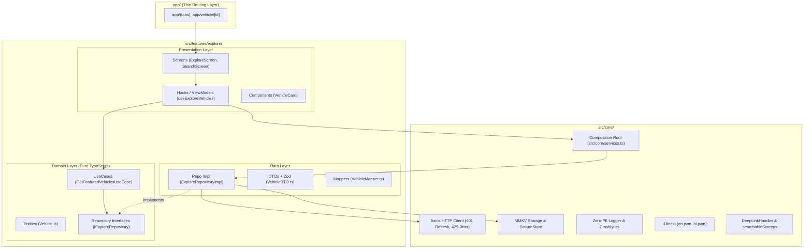

# 🏍️ MyHonda India Mobile Application

> **Enterprise-grade, high-performance, and scalable React Native (Expo) architecture engineered for the MyHonda India customer mobile app.**

---

## 📋 Table of Contents
1. [Architecture Overview](#1-architecture-overview)
2. [Why This Stack? (Comprehensive Library Comparison Table)](#2-why-this-stack-comprehensive-library-comparison-table)
3. [Complete Project Structure](#3-complete-project-structure)
4. [Clean Architecture & SOLID Principles](#4-clean-architecture--solid-principles)
5. [Pure Functional Architecture & Services Composition Root](#5-pure-functional-architecture--services-composition-root)
6. [Ultra-Strict TypeScript & Lint Rules](#6-ultra-strict-typescript--lint-rules)
7. [Internationalization (i18n) Engine](#7-internationalization-i18n-engine)
8. [Deep Linking & Route Navigation](#8-deep-linking--route-navigation)
9. [Zero Memory Leaks & Performance Guardrails](#9-zero-memory-leaks--performance-guardrails)
10. [Observability, Security & Firebase Readiness](#10-observability-security--firebase-readiness)
11. [Quality Gates & CI/CD Verification](#11-quality-gates--cicd-verification)
12. [Developer Guide: How to Add a New Feature](#12-developer-guide-how-to-add-a-new-feature)

---

## 1. Architecture Overview

This project implements **Clean Architecture** with a **Feature-Driven (Vertical Slice)** structural pattern. 

### Dependency Rule (Inward-Only)
Dependencies point strictly inward. The **Domain** layer is the core of business logic and is completely independent of frameworks, UI components, databases, and third-party SDKs.

```
       UI (Expo Router / Screens)
                   │
                   ▼
     Presentation (Hooks / ViewModels)
                   │ calls
                   ▼
     Domain (Entities, UseCases, Interfaces)  ◄── PURE TYPESCRIPT (Zero React, Zero Axios)
                   ▲ implements
                   │
     Data (Repositories, Axios, DTOs, Mappers, MMKV Storage)
```



---

## 2. Why This Stack? (Comprehensive Library Comparison Table)

Every library in this template was selected based on strict criteria: **low bundle footprint, high runtime performance (60–120 FPS), minimal re-render cascades, and enterprise maintenance standards**.

| Category | Library Used | Popular Alternative | Why Chosen? (Technical Benefit Over Alternative) |
| :--- | :--- | :--- | :--- |
| **Framework & Build** | **Expo (Prebuild / CNG)** | Bare React Native CLI | **Automated Upgrades & No Fragile Native Diffs**: Continuous Native Generation (CNG) creates `android/` and `ios/` from config plugins. In bare CLI, React Native upgrades frequently break native Gradle/Xcode files. Expo also provides EAS cloud builds and dev client isolation. |
| **Routing & Navigation** | **Expo Router v58** | React Navigation (Imperative) | **File-Based + Compile-Time Typed Routes**: Deep linking, universal links, nested layouts, and URL parameters are automatic without managing fragile navigation container state trees. Eliminates route string typos via TypeScript union generation (`declare module 'expo-router'`). |
| **Server State & API Cache** | **TanStack Query v5 (React Query)** | Redux Toolkit (RTK Query) | **80% Less Boilerplate**: RTK Query requires defining Redux slices, root reducers, custom middleware, and hooks. TanStack Query manages caching, garbage collection, window refocusing, request deduplication, and retry logic in 2 lines of code without polluting the global store. |
| **Client / Global State** | **Zustand** | Redux Toolkit / MobX | **Zero-Boilerplate & Micro-Re-renders**: Redux requires actions, reducers, dispatchers, and context providers. Zustand is <1KB, requires no context wrapper, and supports selector-based subscriptions (`useStore(s => s.token)`) preventing full-tree re-renders on state change. |
| **Forms & Validation** | **React Hook Form + Zod** | Formik + Yup | **Uncontrolled Inputs (Zero Keystroke Lag)**: Formik re-renders the entire component tree on every keystroke. React Hook Form uses ref-based uncontrolled inputs, giving 60fps typing on low-end Androids. **Zod** automatically derives compile-time TypeScript types (`z.infer<typeof Schema>`). |
| **Fast KV Storage** | **react-native-mmkv** | AsyncStorage | **Synchronous C++ Bridge (30x Faster)**: AsyncStorage crosses the asynchronous JavaScript-to-Native JSON bridge, causing lag during app launch. MMKV uses direct memory-mapped files via C++ JSI/Nitro bindings, executing operations synchronously without freezing the UI thread. |
| **Secure Credentials** | **expo-secure-store** | react-native-keychain | **Hardware-Level Keychain / Keystore**: Direct hardware-backed encryption (iOS Keychain & Android Keystore) specifically designed for sensitive JWT access/refresh tokens and biometric flags. |
| **List Virtualization** | **@shopify/flash-list** | React Native FlatList | **Cell Recycling (Zero Blank Spaces)**: FlatList creates and destroys views on scroll, causing memory spikes and blank screens during fast scrolling. FlashList recycles native views across rows, guaranteeing 60-120 FPS scrolling with 5-10x lower memory consumption. |
| **UI Primitives & Styling** | **Design System Tokens (`colors.ts`)** | Hardcoded StyleSheet / NativeWind | **Strict Compile-Time Color Safety**: Prevents developers from typing literal hex/rgb codes in UI files. Design System tokens enforce unified brand consistency, dark mode readiness, and fail immediately in ESLint and TypeScript if breached. |
| **Icons** | **lucide-react-native** | @expo/vector-icons | **Tree-Shakeable Modern SVGs**: Vector icon fonts load entire font files into memory. Lucide exports pure SVG components, importing only the exact icons used in your bundle. |
| **Internationalization** | **i18next + react-i18next** | react-intl / Custom JSON | **Industry Standard & Pluralization Support**: Seamless runtime language switching without restarting the app, nested namespaces, device locale detection (`expo-localization`), and fallback language safety. |
| **HTTP Client** | **Axios (Wrapped)** | Native `fetch` | **Interceptors for Enterprise Auth**: Native `fetch` lacks built-in interceptors. Axios allows intercepting 401 Unauthorized responses to perform single-flight token refresh queues, 429 rate limit jitter backoffs, and correlation ID injection. |
| **Architecture Linter** | **dependency-cruiser** | ESLint import rules alone | **True Layer Isolation Enforcement**: Validates that domain layers never import React or infrastructure, and features never cross-import each other. Catches structural rot in CI before code is merged. |
| **Architecture Paradigm** | **Pure Functional Architecture (Closures & Factory Functions)** | Class-Based OOP / Inversify / TSyringe | **Hermes Zero-Overhead & Immutability**: Class-based DI containers rely on `reflect-metadata` and experimental decorators, which inflate Hermes bundle sizes and cause slow cold starts. Pure functional factory closures (`createExploreRepository(httpClient)`) offer instant startup (0ms), effortless testing with direct argument mocking, and 100% type safety without decorators or runtime reflection. |
| **Quality Gate** | **SonarQube (`sonar-project.properties`)** | Codecov alone | **Deep Static Analysis**: Identifies code smells, security vulnerabilities, duplicate code blocks (CPD), and enforces enterprise test coverage thresholds. |

---

## 3. Complete Project Structure

```text
myhonda-india/
├── app/                                       # EXPO ROUTER: THIN ROUTE DECLARATIONS ONLY
│   ├── _layout.tsx                            # Root Layout (QueryClient, SafeArea, DI, i18n, Deep Link listeners)
│   ├── +not-found.tsx                         # 404 Route handling invalid deep links
│   ├── (tabs)/                                # Tab Navigation Group
│   │   ├── _layout.tsx                        # Bottom Tab Bar UI & Tab definitions
│   │   ├── index.tsx                          # / (Explore Tab - renders <ExploreScreen />)
│   │   ├── search.tsx                         # /search (Search Tab - renders <SearchScreen />)
│   │   ├── service.tsx                        # /service (Service Booking Journey placeholder)
│   │   └── profile.tsx                        # /profile (Profile & Language Switcher)
│   └── vehicle/
│       └── [id].tsx                           # /vehicle/:id (Deep-linkable vehicle details view)
│
├── src/
│   ├── core/                                  # TECHNICAL FOUNDATION (Zero Feature Business Rules)
│   │   ├── services.ts                        # COMPOSITION ROOT: Pure functional services registry
│   │   ├── network/                           # NETWORKING & API LAYER
│   │   │   ├── httpClient.ts                  # IHttpClient interface (GET, POST, PUT, DELETE)
│   │   │   ├── axiosHttpClient.ts             # Axios with 401 single-flight refresh & 429 backoff
│   │   │   └── apiError.ts                    # Unified domain error model (AppError)
│   │   ├── storage/                           # PERSISTENCE LAYER
│   │   │   ├── localStorage.ts                # Fast MMKV engine with safe Expo Go memory fallback
│   │   │   └── secureStorage.ts               # expo-secure-store Keychain/Keystore wrapper
│   │   ├── i18n/                              # LOCALIZATION LAYER
│   │   │   ├── i18n.ts                        # i18next configuration & device locale detection
│   │   │   ├── useAppTranslation.ts           # Type-safe translation hook with autocompleting keys
│   │   │   └── locales/
│   │   │       ├── en.json                    # English strings dictionary
│   │   │       └── hi.json                    # Hindi strings dictionary
│   │   ├── observability/                     # LOGGING & MONITORING
│   │   │   ├── logger.ts                      # Zero-PII Logger (Auto-redacts mobile, OTPs, VINs)
│   │   │   └── crashlyticsService.ts          # Firebase Crashlytics abstraction (Breadcrumbs & Errors)
│   │   ├── notifications/                     # PUSH NOTIFICATIONS
│   │   │   └── pushNotificationService.ts     # Firebase FCM token & deep-link tap router
│   │   ├── navigation/                        # ROUTING & DEEP LINKS
│   │   │   └── deepLinkHandler.ts             # URI parser & router for `myhonda://` scheme
│   │   └── hooks/                             # MEMORY & LIFECYCLE HOOKS
│   │       ├── useSafeListener.ts             # Memory-leak-free AppState event listener
│   │       └── useSafeAsync.ts                # Unmounted component setState guard
│   │
│   ├── design-system/                         # DESIGN SYSTEM (Reusable Tokens & Primitives)
│   │   ├── tokens/
│   │   │   ├── colors.ts                      # STRICT: Single Source of Truth for all Colors
│   │   │   ├── typography.ts                  # Font sizes, line heights, font weights
│   │   │   └── spacing.ts                     # 4px spacing scale & border radius tokens
│   │   └── primitives/                        # FOLDER-PER-COMPONENT ATOMIC DESIGN
│   │       ├── AppText/                       # Typography primitive
│   │       │   ├── AppText.tsx
│   │       │   ├── AppText.types.ts
│   │       │   ├── AppText.styles.ts
│   │       │   └── index.ts
│   │       ├── AppButton/                     # Accessible 48dp button
│   │       │   ├── AppButton.tsx
│   │       │   ├── AppButton.types.ts
│   │       │   ├── AppButton.styles.ts
│   │       │   └── index.ts
│   │       ├── AppInput/                      # Text input with validation & icons
│   │       │   ├── AppInput.tsx
│   │       │   ├── AppInput.types.ts
│   │       │   ├── AppInput.styles.ts
│   │       │   └── index.ts
│   │       ├── ScreenContainer/               # SafeAreaView + KeyboardAvoidingView + Tablet Constraint
│   │       │   ├── ScreenContainer.tsx
│   │       │   ├── ScreenContainer.types.ts
│   │       │   ├── ScreenContainer.styles.ts
│   │       │   └── index.ts
│   │       └── index.ts                       # Primitives public barrel export
│   │
│   └── features/                              # BUSINESS MODULES (Feature-First Architecture)
│       └── explore/                           # REFERENCE FEATURE: Explore & Discovery
│           ├── domain/                        # PURE TYPESCRIPT DOMAIN LAYER
│           │   ├── entities/
│           │   │   └── Vehicle.ts             # Vehicle domain entity
│           │   ├── repositories/
│           │   │   └── IExploreRepository.ts  # Repository contract interface
│           │   └── usecases/
│           │       ├── GetFeaturedVehiclesUseCase.ts # Fetches & sorts featured models
│           │       └── SearchVehiclesUseCase.ts      # Filters models by query string
│           ├── data/                          # INFRASTRUCTURE & DATA LAYER
│           │   ├── dto/
│           │   │   └── VehicleDTO.ts          # Zod schema & DTO types for API contract
│           │   ├── mappers/
│           │   │   └── VehicleMapper.ts       # Converts DTOs to Domain Entities
│           │   └── repositories/
│           │       └── ExploreRepositoryImpl.ts # Implements IExploreRepository with fallback mocks
│           ├── presentation/                  # REACT & UI LAYER (Container + Presenter + Styles)
│           │   ├── hooks/
│           │   │   ├── useExploreVehicles.ts  # TanStack Query hook (5min staleTime, 10min gcTime)
│           │   │   └── useVehicleSearch.ts    # Debounced (150ms) search hook
│           │   ├── components/                # FOLDER-PER-COMPONENT ATOMIC DESIGN
│           │   │   ├── VehicleCard/
│           │   │   │   ├── VehicleCard.tsx
│           │   │   │   ├── VehicleCard.types.ts
│           │   │   │   ├── VehicleCard.styles.ts
│           │   │   │   └── index.ts
│           │   │   ├── ScreenResultCard/
│           │   │   │   ├── ScreenResultCard.tsx
│           │   │   │   ├── ScreenResultCard.types.ts
│           │   │   │   ├── ScreenResultCard.styles.ts
│           │   │   │   └── index.ts
│           │   │   └── index.ts
│           │   └── screens/                   # FOLDER-PER-SCREEN (Container + Presenter + Styles)
│           │       ├── Explore/
│           │       │   ├── ExploreContainer.tsx   # Smart container (hooks & routing)
│           │       │   ├── ExplorePresenter.tsx   # Pure presenter (Storybook ready)
│           │       │   ├── ExplorePresenter.types.ts
│           │       │   ├── ExplorePresenter.styles.ts
│           │       │   └── index.ts
│           │       ├── Search/
│           │       │   ├── SearchContainer.tsx
│           │       │   ├── SearchPresenter.tsx
│           │       │   ├── SearchPresenter.types.ts
│           │       │   ├── SearchPresenter.styles.ts
│           │       │   └── index.ts
│           │       ├── VehicleDetails/
│           │       │   ├── VehicleDetailsContainer.tsx
│           │       │   ├── VehicleDetailsPresenter.tsx
│           │       │   ├── VehicleDetailsPresenter.types.ts
│           │       │   ├── VehicleDetailsPresenter.styles.ts
│           │       │   └── index.ts
│           │       └── index.ts
│           └── index.ts                       # Public Feature API (encapsulation boundary)
│
├── .dependency-cruiser.js                     # Architecture boundary rules configuration
├── eslint.config.mjs                          # Ultra-strict ESLint flat configuration
├── sonar-project.properties                   # SonarQube quality gate properties
├── tsconfig.json                              # Strict TypeScript configuration
├── app.json                                   # Expo app manifest & deep linking scheme
└── package.json                               # Dependencies & build scripts
```

---

## 4. Clean Architecture & SOLID Principles

### SOLID Principles Mapping

| Principle | Practical Mobile Implementation in this Codebase |
| :--- | :--- |
| **S - Single Responsibility** | `ExploreScreen.tsx` only renders JSX. `useExploreVehicles.ts` manages query state. `GetFeaturedVehiclesUseCase.ts` only applies business rules (sorting). `VehicleMapper.ts` only converts schemas. `ExploreRepositoryImpl.ts` only executes HTTP calls. |
| **O - Open / Closed** | Payment gateways, Push Notification providers, and Storage engines are hidden behind interfaces (`IHttpClient`, `ILocalStorage`, `IPushNotificationService`). You can swap Plivo for Gupshup or MMKV for SQLite by providing a new functional factory closure without modifying existing features. |
| **L - Liskov Substitution** | In offline or test environments, mock implementations satisfy the exact same interface contract as production implementations without breaking callers. |
| **I - Interface Segregation** | Rather than a bloated `ApiService` with 100 methods, interfaces are granular: `IExploreRepository`, `IHttpClient`, `ISecureStorage`. |
| **D - Dependency Inversion** | High-level modules (`useExploreVehicles`, `useVehicleSearch`) do NOT depend directly on concrete API adapters. Both depend on domain contracts (`IExploreRepository`). The single **Composition Root** (`src/core/services.ts`) wires concrete factory closures to domain interfaces. |

---

## 5. Pure Functional Architecture & Services Composition Root

This project is built on a **100% Functional Paradigm** across every single layer:
* **Zero Class Components** (pure React functional components with hooks).
* **Zero Class Repositories / Services** (pure factory closures returning interface contracts).
* **Zero `this` context binding bugs** and zero runtime reflection overhead on Hermes engine.

### Why Not Traditional Class-Based DI Containers?
Traditional DI containers (`InversifyJS`, `TSyringe`) rely on `reflect-metadata` and experimental decorators:
1. They drastically increase JS bundle size and slow down Hermes V8/bytecode parsing on mobile.
2. They introduce runtime reflection overhead, delaying the app's initial paint (TTI).
3. They introduce `this` binding fragility and minification issues with Hermes R8 obfuscation.

### Our Solution: Functional Factory Closures & Composition Root (`src/core/services.ts`)

#### 1. Repository Factory Closure (`src/features/explore/data/repositories/ExploreRepositoryImpl.ts`)
```typescript
export function createExploreRepository(httpClient: IHttpClient): IExploreRepository {
  return {
    async getFeaturedVehicles(): Promise<Vehicle[]> {
      const response = await httpClient.get<unknown>('/v1/vehicles/featured');
      return toVehicleDomainList(VehicleListDTOSchema.parse(response));
    },
    async searchVehicles(query: string): Promise<Vehicle[]> {
      // Pure search logic
    },
    async getVehicleById(id: string): Promise<Vehicle | null> {
      // Pure fetch logic
    },
  };
}
```

#### 2. Centralized Composition Root (`src/core/services.ts`)
```typescript
import { createHttpClient } from './network/axiosHttpClient';
import { secureStorage } from './storage/secureStorage';
import { localStorage } from './storage/localStorage';
import { logger } from './observability/logger';
import { crashlyticsService } from './observability/crashlyticsService';
import { pushNotificationService } from './notifications/pushNotificationService';
import { createExploreRepository } from '@/features/explore/data/repositories/ExploreRepositoryImpl';

const httpClient = createHttpClient('https://api.myhonda.in', secureStorage);

export const services = {
  httpClient,
  secureStorage,
  localStorage,
  logger,
  crashlytics: crashlyticsService,
  pushNotifications: pushNotificationService,
  exploreRepo: createExploreRepository(httpClient),
};
```

#### 3. Pure Use Cases & Direct Hook Consumption
```typescript
// Pure Use Case Function (Domain)
export async function getFeaturedVehicles(repository: IExploreRepository): Promise<Vehicle[]> {
  const vehicles = await repository.getFeaturedVehicles();
  return [...vehicles].sort((a, b) => b.exShowroomPriceINR - a.exShowroomPriceINR);
}

// Presentation Hook (Direct & 100% Type-Safe)
export function useExploreVehicles() {
  return useQuery({
    queryKey: ['vehicles', 'featured'],
    queryFn: () => getFeaturedVehicles(services.exploreRepo),
  });
}
```
**Benefits:**
* **0ms Cold-Start Overhead**: No runtime dictionary lookups, no reflection parsing.
* **Instant Unit Testing**: Mock dependencies by passing a plain mock object to pure functions (`getFeaturedVehicles(mockRepo)`).
* **Rock-Solid Refactoring**: Full IDE autocomplete and jump-to-definition.

---

## 6. Ultra-Strict TypeScript & Lint Rules

### A. Zero Hardcoded Colors Rule
All colors in the app must originate from `src/design-system/tokens/colors.ts`. Colors are defined as a recursive dot-notation union:
```typescript
export type ColorToken = 
  | 'brand.primary'
  | 'brand.secondary'
  | 'surface.background'
  | 'surface.card'
  | 'text.primary'
  | 'text.muted'
  | 'status.error';
```

If any developer tries to pass a raw hex string or unrecognized color, TypeScript will throw a compile error:
```tsx
// ❌ COMPILE ERROR: Argument of type '"#CC0000"' is not assignable to parameter of type 'ColorToken'
<AppText color="#CC0000">Honda</AppText>

// ✅ COMPILES: 100% type-safe
<AppText color="brand.primary">Honda</AppText>
```
In addition, the ESLint rule `'react-native/no-color-literals': 'error'` scans the codebase and fails the CI pipeline if any inline style contains a color literal (`#fff`, `rgb(...)`, `hsl(...)`).

### B. Zero Hardcoded Raw Text Rule
To guarantee internationalization compliance, ESLint rule `'react-native/no-raw-text': ['error', { skip: ['AppText'] }]` ensures no unlocalized strings exist inside native `<Text>` components. All strings must come from the i18n dictionary.

---

## 7. Internationalization (i18n) Engine

* **Dictionaries:** `src/core/i18n/locales/en.json` (English) and `src/core/i18n/locales/hi.json` (Hindi).
* **Autocomplete & Validation:** The `useAppTranslation()` hook extracts all nested JSON keys into a strictly-typed string union (`TranslationKey`).

```tsx
import { useAppTranslation } from '@/core/i18n/useAppTranslation';
import { AppText } from '@/design-system/primitives/AppText';

export const MyComponent = () => {
  const { t, currentLanguage, changeLanguage } = useAppTranslation();

  return (
    <>
      {/* Typesafe key autocompletion */}
      <AppText>{t('explore.title')}</AppText>
      
      {/* 1-click language switch */}
      <AppButton 
        title="Switch Language" 
        onPress={() => changeLanguage(currentLanguage === 'en' ? 'hi' : 'en')} 
      />
    </>
  );
};
```

---

## 8. Deep Linking, Screen Navigation & Spotlight Search

### A. Unified App & Screen Search (Spotlight Pattern)
Users can search **both app screens/features and vehicle models** directly from the search bar (`SearchScreen.tsx`):
* Search `"Service"` ➔ Displays **Book Service** action card (`/(tabs)/service`).
* Search `"Profile"` or `"Language"` ➔ Displays **My Profile & Language** screen card (`/(tabs)/profile`).
* Search `"Manual"` ➔ Displays **Digital Owner Manual** screen card.
* Search `"Activa"` or `"CB350"` ➔ Displays **Vehicle Model** card.

Tapping any screen result invokes `router.push(screen.route)` and takes the user straight to that screen.

### B. Configured URL Scheme
* **URL Scheme:** `myhonda://` (declared in `app.json`).
* **Deep Link Parser:** `src/core/navigation/deepLinkHandler.ts`.
* **Searchable Registry:** `src/core/navigation/searchableScreens.ts`.

### Testing Deep Links on iOS Simulator:
```bash
# 1. Search for Service screen:
xcrun simctl openurl booted "exp://127.0.0.1:8081/--/(tabs)/search?query=Service"

# 2. Search for Profile screen:
xcrun simctl openurl booted "exp://127.0.0.1:8081/--/(tabs)/search?query=Profile"

# 3. Search for a specific model (e.g. Activa):
xcrun simctl openurl booted "exp://127.0.0.1:8081/--/(tabs)/search?query=Activa"

# 4. Open Specific Vehicle Detail Screen directly:
xcrun simctl openurl booted "exp://127.0.0.1:8081/--/vehicle/hness-cb350"
```

---

## 9. Zero Memory Leaks & Performance Guardrails

1. **View Recycling:** Heavy lists use **FlashList** instead of FlatList. Native views are recycled across rows rather than allocated and destroyed on every scroll event.
2. **AppState & Event Teardown:** The `useSafeAppState()` hook automatically unbinds native event subscriptions on component unmount:
   ```typescript
   useSafeAppState(() => {
     console.log('App in foreground');
   });
   ```
3. **Async State Guards:** `useSafeAsync()` wraps asynchronous promises so unmounted components never call `setState`, eliminating memory retention of defunct views.
4. **Smart Storage Fallback:** `src/core/storage/localStorage.ts` automatically detects if native Nitro/MMKV bindings exist. Inside Expo Go, it uses a memory-backed key-value store; in standalone or dev client builds, it activates the ultra-fast C++ MMKV engine.

---

## 10. Observability, Security & Firebase Readiness

### Zero-PII Logger (`src/core/observability/logger.ts`)
Production logs must never leak Personally Identifiable Information (PII). The custom logger automatically redacts sensitive data using regular expressions before printing:
* **Indian Mobile Numbers:** `[6-9]\d{9}` ➔ `[REDACTED]`
* **OTPs (4 to 6 digits):** `\b\d{4,6}\b` ➔ `[REDACTED]`
* **JWT Tokens:** `Bearer eyJ...` ➔ `[REDACTED]`
* **17-character VIN/Chassis numbers:** `[REDACTED]`

### Firebase Crashlytics & Push Notifications
* **Crashlytics:** `src/core/observability/crashlyticsService.ts` provides non-fatal error logging and breadcrumb capture. When native `@react-native-firebase/crashlytics` is installed, simply uncomment the native calls in this single file.
* **FCM Push Notifications:** `src/core/notifications/pushNotificationService.ts` handles device token retrieval, permission prompts, and payload parsing. When a user taps a push notification, it automatically routes to the appropriate deep link (`/vehicle/:id`, `/search`, etc.).

---

## 11. Quality Gates & CI/CD Verification

Three independent automated quality gates are configured:

```bash
# Run ALL checks in one command:
npm run validate
```

### Individual Commands:
```bash
# 1. Typecheck the entire codebase with strict TypeScript
npm run typecheck

# 2. Enforce Clean Architecture boundary rules (Dependency Cruiser)
npm run arch:check

# 3. Lint strict design-system color tokens and i18n text
npm run lint

# 4. Auto-fix linting issues
npm run lint:fix

# 5. Format code with Prettier
npm run format
```

### SonarQube Quality Gate
Configured in `sonar-project.properties`:
* Project Key: `com.honda.india:myhonda-mobile`
* Excludes tests and DI composition root from code duplication metrics.
* Compatible with SonarCloud and local SonarQube runners.

---

## 12. Developer Guide: How to Add a New Feature

When creating a new feature (e.g., `features/service-booking/`), follow this standard pattern:

1. **Domain Layer (`domain/`):**
   * Create entities in `domain/entities/Booking.ts` (pure TypeScript).
   * Define repository interface in `domain/repositories/IBookingRepository.ts`.
   * Create usecases in `domain/usecases/CreateBookingUseCase.ts`.
2. **Data Layer (`data/`):**
   * Create validation schemas in `data/dto/BookingDTO.ts` using **Zod**.
   * Create mapper in `data/mappers/BookingMapper.ts`.
   * Implement repository in `data/repositories/BookingRepositoryImpl.ts` using `IHttpClient`.
3. **Presentation Layer (`presentation/`):**
   * Create query/mutation hooks in `presentation/hooks/useCreateBooking.ts` using **TanStack Query**.
   * Create UI screens in `presentation/screens/BookingScreen.tsx` using `ScreenContainer`, `AppText`, and `AppButton`.
4. **Register in Composition Root (`src/core/services.ts`):**
   * Instantiate factory (`createBookingRepository(httpClient)`) and expose on `services.bookingRepo`.
5. **Add Expo Router Route (`app/`):**
   * Add thin route file `app/service/book.tsx` that simply imports and renders `<BookingScreen />`.
